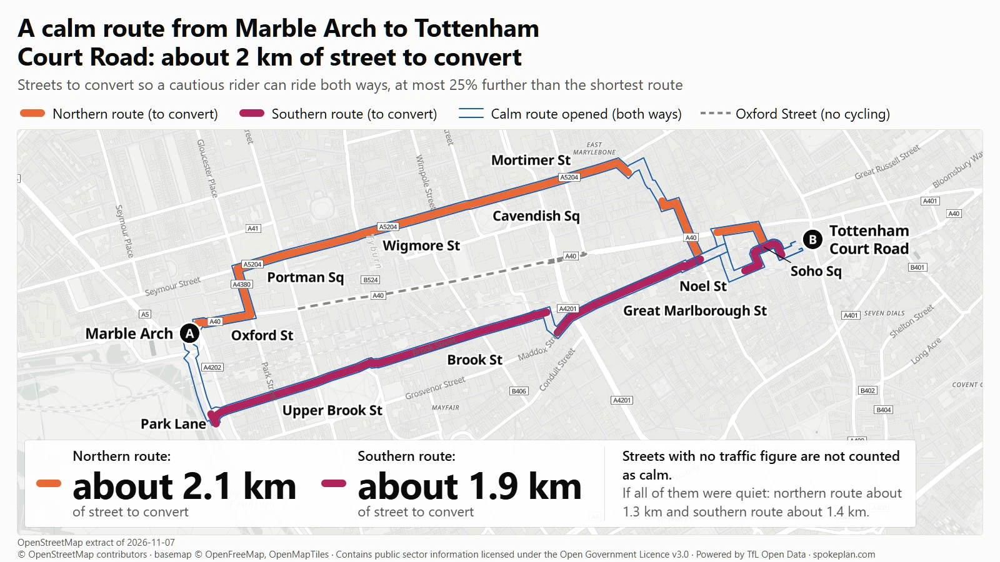

# Oxford Street cycling study

Since 26 October 2026, the central stretch of Oxford Street in London (between Orchard Street and Great Portland Street) has been a pedestrian zone with no cycling. This repository holds the open data, code and figures behind an article measuring what the ban costs a rider between Marble Arch and Tottenham Court Road, and what it would take to open a calm route round it.



**In three lines:**

1. **Confident rider:** loses a few hundred metres, about a minute at most, pushed onto Wigmore Street and Mortimer Street.
2. **Cautious rider (low-stress streets only):** has no route between Marble Arch and Tottenham Court Road under every check that accounts for traffic volume, including the Department for Transport's mixed-traffic limit (LTN 1/20: 2,500 vehicles a day at 20 mph).
3. **Street to convert for a calm two-way route:** about 2.1 km north of Oxford Street or 1.9 km south of it (assuming unmeasured streets are not calm, and converted one-way streets can be ridden both ways). If every unmeasured street were quiet, those figures drop to about 1.3 km north and 1.4 km south.

This study does not propose a new route. It tests whether a cautious rider can cross today, and measures how much street stands in the way.

Everything runs on published data (an OpenStreetMap extract of 2026-11-07, Department for Transport traffic counts, counts published by Transport for London, Camden and Westminster, and the London Atmospheric Emissions Inventory 2022) and open software (Bun, osmium-tool, Valhalla). The study was made by [SpokePlan](https://spokeplan.com), a cycling route planner, but none of the measurements depend on it.

## Start here

| If you want to… | Go to |
|---|---|
| Read the article | &lt;link to follow&gt; |
| Download press-ready maps (3,200 px PNG/WebP, CC BY 4.0) | [figures/README.md](figures/README.md) |
| Check every sensitivity test, assumption and unrounded figure | [docs/article-notes.md](docs/article-notes.md) |
| Open the route GeoJSONs or street tables without running code | [Key result files](#key-result-files) |
| Read the full LTS rules, matching logic and scenario specs | [docs/lts.md](docs/lts.md) |
| Rerun the analysis locally | [Reproduce](#reproduce) |

## Key result files

All outputs are committed under `results/`, so you can inspect the numbers in a spreadsheet or drop any `.geojson` straight into [geojson.io](https://geojson.io) or QGIS without installing anything.

| What you want to check | File |
|---|---|
| Northern route streets to convert (GeoJSON, main reading) | [gap-closing-contraflow.geojson](results/lts/sensitivity/side-comparison/best-evidence/furth2017-high/north-only/gap-closing-contraflow.geojson) |
| Southern route streets to convert (GeoJSON, main reading) | [gap-closing-contraflow.geojson](results/lts/sensitivity/side-comparison/best-evidence/furth2017-high/south-only/gap-closing-contraflow.geojson) |
| North vs. south comparison (all four gradings) | [side-comparison.csv](results/lts/sensitivity/side-comparison.csv) |
| Headline street-by-street lengths and traffic data sources | [headline-streets.csv](results/lts/sensitivity/best-evidence/headline-streets.csv) |
| Sensitivity and robustness checks (LTN 1/20, LAEI halved/doubled, 20 mph column, etc.) | [robustness.csv](results/lts/sensitivity/best-evidence/robustness.csv) |
| All 32 best-evidence runs and how often each street appears | [runs.csv](results/lts/sensitivity/best-evidence/runs.csv), [frequency.csv](results/lts/sensitivity/best-evidence/frequency.csv) |
| Confident-rider detour distances and times | [detour-summary.csv](results/lts/detour-summary.csv) |
| Published side-street counts compiled from TfL, Camden and Westminster | [counts.csv](inputs/published-counts/counts.csv) ([sources & rules](inputs/published-counts/README.md)) |
| DfT count points matched to OSM ways | [countpoints-matched.csv](results/dft/countpoints-matched.csv) |
| LAEI 2022 modelled traffic flows per street | [streets.csv](results/laei/streets.csv) |

## Findings

Trip ends: **A** Marble Arch (−0.15874, 51.51320) and **B** Tottenham Court Road (−0.13027, 51.51587). Unless noted, the headline figures below come from the **best-evidence run** (DfT and published counts first, then LAEI 2022 modelled flows, then class defaults for remaining unmeasured streets, with Great Chapel Street graded traffic-free). Every rule and parameter is in [docs/lts.md](docs/lts.md).

1. **Confident rider: about a minute at most.** On the study's street graph, the shortest rideable path today is 2,385 m A→B and 2,508 m B→A between the Furth 2017 low-stress snap nodes (the `mekuria2012` rows and the routes figure snap to different nodes and give 2,424 / 2,507 m). Against a reconstruction with pedestrianised Oxford Street reopened to cycling, it is 2,056 m / 2,295 m, so the detour is +329 m / +213 m, or 52 s / 36 s at Valhalla's average speed on these trips (`results/lts/detour-summary.csv`). Valhalla's own bicycle route runs along Wigmore Street and Mortimer Street: 2,595 m in 407 s A→B, 2,796 m in 472 s B→A (`results/valhalla/today/`).
2. **Cautious rider (LTS ≤ 2): no low-stress route.** Under the best-evidence grading, the LTS ≤ 2 network does not connect A and B in either direction across any scenario or robustness check (`results/lts/sensitivity/best-evidence/robustness.csv`), including DfT's mixed-traffic limit (LTN 1/20, paragraph 7.1.1: 2,500 vehicles a day at 20 mph), halving LAEI flows, setting every unmeasured street to zero traffic, or using counts alone with every other street set to zero. The same holds under BikeOttawa's rules, every DfT-only Furth 2017 variant, and the untagged-unlaned sensitivity. Only the volume-free 2012 table (`mekuria2012`) connects A and B (1.19 and 1.21 times the shortest path today; B→A fails once the closure is sealed, at 1.27).
3. **Street to convert: about 1.9 to 2.1 km (main reading) or 1.3 to 1.4 km (quiet back streets).** Searching for the fewest metres of LTS 3 street that, made low-stress (two-way tracks allowed), open an acceptable LTS ≤ 2 route (path ≤ max(1.25 × shortest, shortest + 536 m)):
   - **Main reading** (unmeasured streets not counted as calm): **2,142 m** north of Oxford Street (opens a 2,573 m ride) or **1,878 m** south of it (opens a 2,485 / 2,530 m ride).
   - **Quiet reading** (every unmeasured street quiet): **1,301 m** north or **1,359 m** south.
   - **Other options** (main reading): a two-way cycle track through the pedestrian zone totals **1,701 m** (1,093 m on Oxford Street including its traffic-carrying ends and crossing, plus 609 m on nearby streets); a full protected track along Wigmore Street still leaves **1,465 m** of connecting streets to convert.
   - **Recurring streets (32 best-evidence runs: 2 volume defaults × 4 scenarios × Oxford Street closed/reopened × one-way/two-way tracks):** no street is in all 32; Carlisle Street (48 m, beside Soho Square) is in 31, Great Marlborough Street and Noel Street in 27, Oxford Street in 19, Soho Square in 16, and Park Lane in 13 (`results/lts/sensitivity/best-evidence/frequency.csv`).
   - **Earlier DfT-only baseline** (no published counts or LAEI flows, Great Chapel Street unadjusted, `results/lts/gap-closing-summary.csv`): 1,113 m (low) and 1,940 m (high) today; Great Chapel Street appeared in 27 of 32 runs there because OpenStreetMap dropped its `motor_vehicle=no` tag in April 2026 even though Westminster says it has operated traffic-free since the pandemic ([docs/lts.md](docs/lts.md#sensitivity-runs)).

**Key caveats.** One origin–destination pair, snapped to the nearest low-stress nodes. The 25% detour test is measured against the shortest ride *after* the ban (up to 45% longer than the old direct ride). Converted metres are not a cost estimate, and the union of both directions is a heuristic upper bound. See [Limitations](#limitations).

## Scenarios and assumptions

| Scenario | Network |
|---|---|
| `today` | The OSM extract as downloaded: the pedestrianised section bans cycling; Oxford Street west to Marble Arch and east to Tottenham Court Road is still a road. |
| `wigmore-track` | `today` with a protected cycle track (`cycleway=track`) on every Wigmore Street way. |
| `full-closure` | `today` with all of Oxford Street, Marble Arch to Tottenham Court Road, pedestrianised with no cycling. Cross-streets stay open and can still cross it. |
| `full-closure-sealed` | `full-closure` with the three short median links across the closed carriageway closed too. LTS only, no Valhalla run. |

The full-length closure is **this study's assumption**, not a published scheme. It is derived from City Hall's 2025 commission for a Whole Street Concept Design covering Marble Arch to Tottenham Court Road, and from the cycling ban on the first phase. Exact tag changes are in [docs/lts.md](docs/lts.md#scenarios); retagged way ids are in `results/scenario-<scenario>.json`.

## Reproduce

Requires [Bun](https://bun.sh) 1.3.14+ and Docker (osmium-tool, plus Valhalla for the optional step; images are pinned by digest). Run from the repository root.

**Core reproduction (no downloads required, a few minutes):**

```sh
bun install --frozen-lockfile
bun run typecheck
bun run reproduce:inputs   # copies committed OSM cut & DfT CSVs (checked against SHA256SUMS), builds scenarios, matches counts
bun run reproduce:lts      # runs all LTS tables, 32 gap-closing runs, best-evidence run, sensitivities & detour summary
```

The detour summary reads the committed `results/valhalla/today/summary.csv`, and the matched LAEI flows are committed in `results/laei/`, so `reproduce:inputs` and `reproduce:lts` reproduce the committed `results/` byte for byte without downloading anything.

**Optional steps:**

```sh
# Re-download LAEI 2022 (11.5 MB, checked against SHA256SUMS) and rebuild results/laei/
bun run reproduce:laei

# Re-run the through-traffic map-only check (results/through/)
bun run reproduce:through

# Re-render all figures (requires outputs from reproduce:lts, Chromium installed once via `bunx playwright install chromium`, and network access for OpenFreeMap tiles + MapLibre GL JS from unpkg)
bun run figures
# Or render a single figure:
bun scripts/figures/render.ts fix-hero

# Re-run Valhalla (about 27 min, mostly tile building; needs the full 130 MB Greater London extract via reproduce:data)
bun run reproduce:data
bun run reproduce:valhalla
```

`bun run reproduce:data` is the original download path (Geofabrik, DfT and LAEI), checked against `inputs/SHA256SUMS`; it rewrites fetch timestamps in `results/extract-info.json` and `results/dft/source.json`. Geofabrik keeps dated extracts for a limited time and DfT republishes yearly, which is why the study-area cut and DfT CSVs are committed under `inputs/`.

## Figures

Press-ready figures live in `figures/`, each as 3,200 px wide PNG and WebP (for print/press) plus `<name>-1600.webp` (for web). Full captions, exact dimensions, data provenance and clickable downloads are in [figures/README.md](figures/README.md).

| Figure | Used in | Shows |
|---|---|---|
| [`fix-hero`](figures/fix-hero.png) | Article lead image | Northern (orange, ~2.1 km) and southern (magenta, ~1.9 km) streets to convert on the main reading, with the quiet-reading note |
| [`fix-hero-og`](figures/fix-hero-og.jpg) | Social card (1200 × 630) | Clean crop of the lead map with length key, no street names |
| [`stress-map`](figures/stress-map.png) | Article | Blue (Marble Arch) and teal (Tottenham Court Road) reachable zones separated by busy orange streets, even with grey streets passable |
| [`long-trip`](figures/long-trip.png) | Article | Hammersmith to Russell Square: SpokePlan's Road preset vs. City preset, showing overlap with the southern route |
| [`evidence`](figures/evidence.png) | Article | Northern vs. southern streets to convert coloured by traffic source (counted, TfL model, no figure) |
| [`routes`](figures/routes.png) | Linked from article | Confident (shortest) and cautious routes today on the study graph, eastbound and westbound |
| [`fix-minimum`](figures/fix-minimum.png) | Linked from article | Street-by-street conversion sets stacked: main reading (top) and quiet unmeasured streets (bottom) |
| [`fix-frequency`](figures/fix-frequency.png) | Linked from article | How often each street appears across the 32 best-evidence runs |
| [`stress-map-readings`](figures/stress-map-readings.png) | Linked from article notes | Two-panel LTS map (unmeasured streets assumed quiet vs. busy) with count-point rings |
| [`options`](figures/options.png) | Supplementary (not in article) | Bar chart comparing north, south and pedestrian-zone track conversion lengths |

**Reuse and credit.** The figures are licensed [CC BY 4.0](https://creativecommons.org/licenses/by/4.0/). Credit them with the exact line printed on each image:

> © OpenStreetMap contributors · basemap © OpenFreeMap, OpenMapTiles · Contains public sector information licensed under the Open Government Licence v3.0 · Powered by TfL Open Data · spokeplan.com

Note: `scripts/figures/chromium.ts` drives Chromium over the DevTools Protocol directly because Playwright's driver hangs under Bun on Windows. Basemap tiles are fetched live from OpenFreeMap Positron, so only the basemap (not the study data) can differ between renders.

## Methods

- **Confident rider (Valhalla):** Valhalla 3.5.1 bicycle routing with three settings (`confident`, `cautious`, `reference`) per trip and scenario; edge attributes from `/trace_attributes` ([valhalla/README.md](valhalla/README.md)).
- **Level of Traffic Stress (LTS):** Every way gets LTS 1 to 4 from its OSM tags. Mixed-traffic blocks come from `bikeottawa`, `mekuria2012` (MTI Report 11-19 Table 4), or `furth2017-low` / `furth2017-high` (Furth 2017 LTS 2.0 volume-based table; painted lanes without physical separation are rated as mixed traffic, following Furth's note for frequently blocked lanes). Sensitivities include `-lt20` (20 mph read in the ≤ 20 mph column), `-unlaned` (untagged two-way residential streets unlaned) and `uk-ltn120` (DfT LTN 1/20 mixed-traffic limit).
- **Connectivity test** (MTI Report 11-19): L4 = shortest rideable path, L2 = shortest path on LTS 1 to 2 only. Acceptable if L2/L4 < 1.25 or L2 − L4 < 536 m.
- **Gap closing:** Exact bi-criteria search for the fewest converted LTS 3 to 4 metres that pass the connectivity test (inclusive bound), with Pareto frontier and two-direction union (`--contraflow` allows two-way tracks on converted one-way streets; `--allow-oxford` makes pedestrianised Oxford Street convertible at LTS 3). The 32 runs cross the two volume-default tables (`furth2017-low`, `furth2017-high`) × four scenarios × both flags, in the 25 mph column.
- **Best-evidence traffic volumes:** Matched DfT and published counts (`count`), carried up to 600 m along the same road (`road`), then LAEI 2022 modelled flows (`laei`), with class defaults (`class-default`) only for remaining streets, plus Great Chapel Street graded traffic-free ([docs/lts.md](docs/lts.md#best-evidence-run)).
- **Through-traffic check:** Tested whether a driving graph alone separates busy from quiet side streets on the 86 counted minor ways; it does not beat calling all of them busy, so it grades nothing ([docs/lts.md](docs/lts.md#through-traffic-check-can-the-map-tell-busy-side-streets-from-quiet-ones)).

## Repository layout

| Path | Contents |
|---|---|
| `inputs/` | Committed raw inputs: study-area OSM cut, DfT CSVs, published counts, SpokePlan long-trip GeoJSONs, `SHA256SUMS` ([inputs/README.md](inputs/README.md)) |
| `scripts/download-extract.ts`, `retag-scenario.ts`, `make-inputs.ts` | OSM extract download/copy, scenario generation and input rebuilding |
| `scripts/dft/`, `published-counts/`, `laei/` | Traffic count matching and LAEI 2022 download, matching and validation |
| `scripts/lts/` | Graph extraction, LTS grading, routing, gap closing, detour, sensitivity and best-evidence runs (`run-all.ts`) |
| `scripts/through/`, `scripts/long-trip/`, `scripts/run-trips.ts`, `valhalla/` | Through-traffic check and Valhalla runs |
| `scripts/figures/` | Figure data preparation, palette/style and headless Chromium rendering |
| `figures/` | Rendered press and web figures ([figures/README.md](figures/README.md)) |
| `docs/article-notes.md` | Plain-English checks, assumptions, caveats and unrounded street-by-street figures |
| `docs/lts.md` | Full LTS rules, tables, scenarios, best-evidence details and outputs |
| `results/` | Committed CSV and GeoJSON outputs |
| `data/` | Generated intermediates (gitignored) |
| `CITATION.cff`, `DATA-LICENSES.md` | Citation metadata and full data licences |

## Limitations

- One origin–destination pair (Marble Arch to Tottenham Court Road). Other West End trips will have other answers. Trip end B snaps 54 m from the station to a service lane; snapping to the nearest rideable node instead raises per-direction minima by about 70 to 180 m.
- Posted limits stand in for prevailing speed (almost every street here is 20 mph). Headline runs read 20 mph in Furth's 25 mph column; `-lt20` shows the gentler reading.
- About half the graded street length (52.1%) has neither a count nor an LAEI flow and takes class-default volumes. On the southern route (main reading), 1,594 of the 1,878 m rest on LAEI modelled flows, 97 m on a carried DfT count and 187 m have no traffic figure.
- Untagged two-way streets are read as having a centreline (two lanes). Most residential streets lack a `lanes` tag; `-unlaned` shows the effect. One-way streets always read the table's one-lane row.
- Painted bike lanes without physical separation are rated as mixed traffic under the Furth 2017 tables.
- LAEI 2022 flows come from a 2019-base strategic model scaled to 2022, predating Wigmore Street going two-way (February 2025) and the Oxford Street ban. Against DfT counts (mostly main roads), about one matched street in four differs by more than a factor of 2 (88 of 117 within). Against published back-street counts, LAEI runs about a quarter high (median 1.26), and roughly one in three differs by more than a factor of 2 (19 of 29 within). Most published counts cover a single day, and 12- and 16-hour counts omit the night.
- The DfT count on Wigmore Street (2019) predates the February 2025 two-way conversion and post-ban bus diversions.
- LTS grades links, not junctions; crossings count only by length. The search never adds a contraflow to an already calm one-way street, biasing minima slightly upward.
- Converted metres are not a cost estimate.
- LTS is a North American method (TfL uses Cycle Route Quality Criteria; Westminster follows UK design guidance). The `uk-ltn120` check applies DfT's mixed-traffic limit and reaches the same connectivity result.
- OSM tagging is taken as found on 2026-11-07. Valhalla's bicycle costing is one engine's view of a confident rider.

## Credits and licences

Study by [SpokePlan](https://spokeplan.com). Map data © OpenStreetMap contributors (ODbL 1.0); DfT road traffic statistics and LAEI 2022 (GLA / TfL) under OGL v3.0; published counts from TfL (Powered by TfL Open Data), Camden and Westminster; mixed-traffic rules ported from the BikeOttawa stress model (MIT). Full attribution and terms: [DATA-LICENSES.md](DATA-LICENSES.md).

Code and documentation: [MIT](LICENSE). Derived data: ODbL 1.0 (with OGL v3.0 where DfT or LAEI values apply; see [DATA-LICENSES.md](DATA-LICENSES.md)).

## How to cite

> SpokePlan (2026). *Oxford Street cycling study: no calm route after the cycling ban, and how much street one would take*. https://github.com/spokeplan/oxford-street-cycling-study

Machine-readable metadata is in [CITATION.cff](CITATION.cff).
